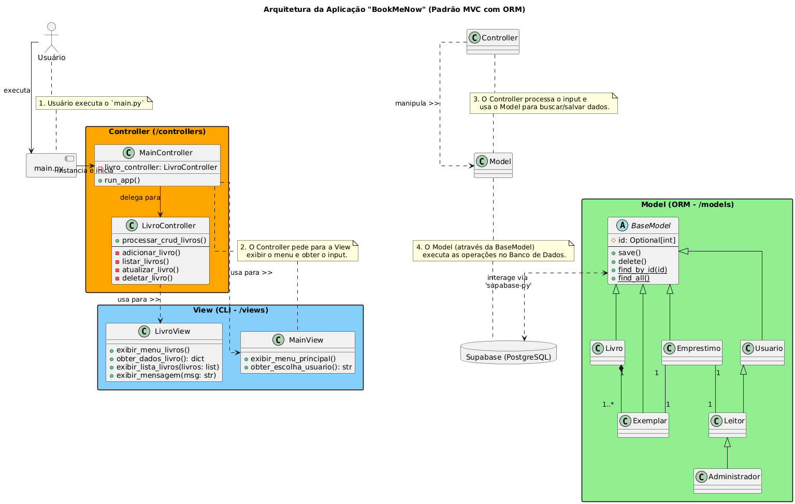

# Projeto BookMeNow

## Sobre o Projeto

**BookMeNow** é uma aplicação de linha de comando (CLI) para gerenciamento de bibliotecas. O sistema foi projetado para lidar com o cadastro de livros, exemplares, usuários e o controle de empréstimos.

A estrutura inicial, a modelagem de classes ORM e a arquitetura MVC.

## Tecnologias Utilizadas

* **Linguagem:** Python 3.9+  
* **Backend & Banco de Dados:** Supabase (PostgreSQL)  
* **Biblioteca de Cliente:** `supabase-py`  
* **Gerenciamento de Configuração:** `python-dotenv`  

## Arquitetura

A arquitetura do projeto é baseada no padrão MVC (Model-View-Controller), com uma camada de dados que implementa um ORM (Object-Relational Mapper) no estilo Active Record.

### MVC (Model-View-Controller)

* **Model:** Camada de dados implementada como ORM (Active Record). As classes em `models/` representam as tabelas do banco e contêm a lógica de persistência.  
* **View:** Camada de apresentação em `views/`, responsável pela interação com o usuário no terminal.  
* **Controller:** Camada de lógica de negócio em `controllers/`, orquestrando o fluxo da aplicação.

### ORM (Padrão Active Record)

As classes herdam de `BaseModel`, permitindo que um objeto, como `Livro`, seja salvo, atualizado ou deletado com métodos próprios (`livro.save()`, `livro.delete()`).

## Como Configurar o Ambiente

1. Clone o repositório  
    ```bash
    git clone <URL_DO_SEU_REPOSITORIO>
    cd <NOME_DO_REPOSITORIO>
    ```

2. Crie e ative um ambiente virtual  
    macOS/Linux:
    ```bash
    python3 -m venv venv
    source venv/bin/activate
    ```
    Windows:
    ```bash
    py -m venv venv
    venv\Scripts\activate
    ```

3. Instale as dependências  
    ```bash
    pip install -r requirements.txt
    ```

4. Configure o banco no Supabase  
    * Crie um novo projeto em https://supabase.com  
    * No **SQL Editor**, execute o DDL para criar as tabelas `livros`, `usuarios`, `exemplares` e `emprestimos`.

5. Adicione credenciais no `.env` na raiz do projeto (`BMN/`):  
    ```
    SUPABASE_URL="SUA_URL_AQUI"
    SUPABASE_KEY="SUA_CHAVE_DE_SERVICO_AQUI"
    ```

## Como Executar

```bash
cd bookmenow
python main.py
```

O menu principal será exibido no terminal para interação.



## Próximos Passos

* Implementar gestão completa de **Exemplares** (listar, atualizar, deletar).  
* Desenvolver CRUD para **Usuários** (Leitores e Administradores).  
* Criar lógica de devolução de **Empréstimos**.  
* Implementar login para diferentes tipos de usuários.  
* Adicionar validação de entrada e tratamento de erros robusto.  
